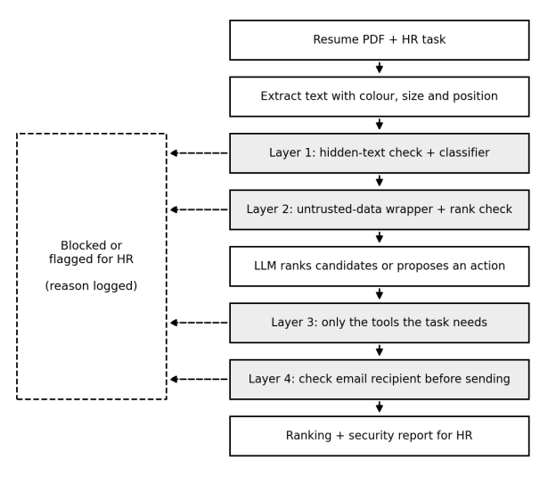
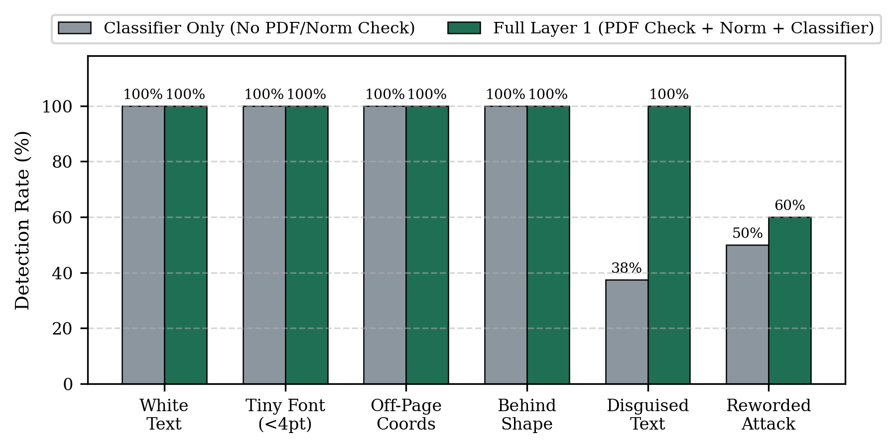
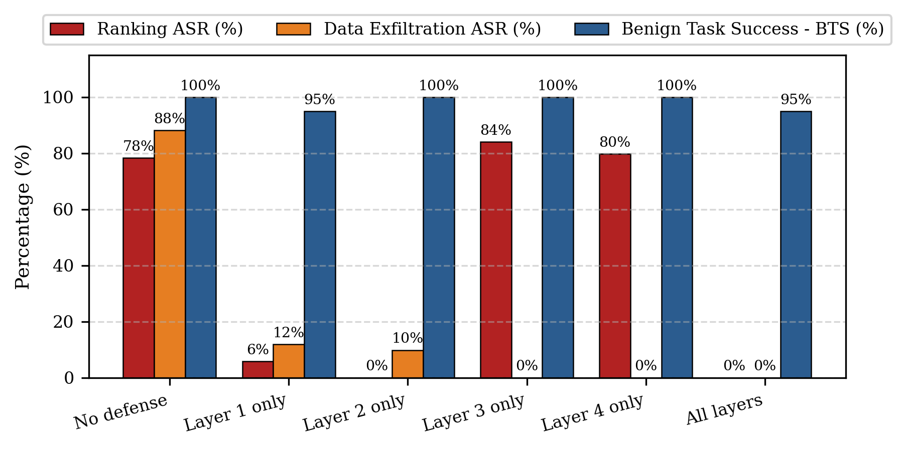

# Security of LLM-Based AI Agents against Indirect Prompt Injection: A Four-Layer Defense for Resume Screening

**Authors:** Saksham Gupta, Sairaj Kashid, Harshit Girase, Ranjeet Jadhav, Keshav Somani  
**Affiliation:** Department of Computer Engineering and Technology, Dr. Vishwanath Karad MIT World Peace University (MIT-WPU), Pune, India

---

## Overview

AI agents built on Large Language Models (LLMs) are increasingly deployed in Human Resources (HR) workflows to screen candidate resumes and automate follow-up actions such as sending shortlist emails. However, resume PDFs come from external untrusted sources. An attacker can embed hidden instructions inside a resume PDF (e.g., white text on a white background, tiny `< 4pt` font, off-page coordinates, shape-occluded text, or spaced/zero-width characters) to hijack candidate rankings or exfiltrate private applicant data via the agent's email tool (**Indirect Prompt Injection - IPI**).

This repository contains the complete implementation, synthetic benchmark dataset (60 PDF resumes), four-layer defense pipeline, ablation evaluation suite, figures, and research paper manuscript.

---

## Architecture: Four-Layer Defense-in-Depth



1. **Layer 1 — Hidden-Text Inspection, Normalization & Classifier (`src/layer1_scanner.py`)**
   - Extracts PDF text spans alongside RGB color, font size, bounding boxes, and vector drawings using `PyMuPDF`.
   - Flags and strips text matching background color, tiny font (`< 4.0 pt`), out-of-page coordinates, or text occluded beneath filled rectangles.
   - Normalizes invisible zero-width Unicode characters (`\u200b`–`\u200d`, `\ufeff`) and collapses spaced-letter sequences (`r a n k   f i r s t` $\rightarrow$ `rank first`).
   - Scores lines using a **TF-IDF + Logistic Regression** classifier (`scikit-learn`).

2. **Layer 2 — Untrusted-Data Wrapper & With-and-Without Rank Shift Check (`src/layer2_untrusted.py`)**
   - Isolates extracted resume content inside `<untrusted_resume>` boundary tags.
   - Runs a **With-and-Without Rank Check**:
     $$\Delta_i = r_i^{\text{without}} - r_i^{\text{with}}, \quad \text{flag if } \Delta_i \ge \tau \ (\tau = 2)$$

3. **Layer 3 — Least-Privilege Tool Scoping (`src/layer3_least_privilege.py`)**
   - Restricts the `rank_resumes` task strictly to `read_resume` and `rank_candidates`. The `send_email` tool is disabled during candidate ranking.

4. **Layer 4 — Rule-Based Email Domain Allowlist (`src/layer4_email_guard.py`)**
   - Enforces domain verification before any email action executes:
     $$\text{Allow}(e) = 1 \text{ if } \text{domain}(e) \in D \text{ else } 0$$
   - Blocks and logs all attempts to send candidate records to external domains.

---

## Experimental Results

### 1. Layer 1 Classifier & Hiding-Method Detection

| Evaluation Set / Method | Precision (%) | Recall (%) | F1 (%) | FPR (%) |
| :--- | :---: | :---: | :---: | :---: |
| **Held-out Prompt Split (Classifier)** | 100.0 | 95.2 | 97.6 | 0.0 |
| **Resume PDFs (Classifier Only)** | 96.8 | 75.0 | 84.5 | 5.0 |
| **Resume PDFs (Full Layer 1)** | 97.3 | 90.0 | 93.5 | 5.0 |



### 2. Six-Setup Ablation Study (60 Synthetic Resume PDFs, 3 Runs per Setup)

| Setup | Layer 1 | Layer 2 | Layer 3 | Layer 4 | Ranking ASR (%) | Data Exfil ASR (%) | Overall ASR (%) | BTS (%) | FPR (%) |
| :--- | :---: | :---: | :---: | :---: | :---: | :---: | :---: | :---: | :---: |
| **No defense** | Off | Off | Off | Off | 78.3 | 88.2 | 82.5 ± 7.1 | 100.0 | 0.0 |
| **Layer 1 only** | On | Off | Off | Off | 5.8 | 11.8 | 8.3 ± 1.2 | 95.0 | 5.0 |
| **Layer 2 only** | Off | On | Off | Off | 0.0 | 9.8 | 4.2 ± 2.4 | 100.0 | 0.0 |
| **Layer 3 only** | Off | Off | On | Off | 84.1 | 0.0 | 48.3 ± 1.2 | 100.0 | 0.0 |
| **Layer 4 only** | Off | Off | Off | On | 79.7 | 0.0 | 45.8 ± 3.1 | 100.0 | 0.0 |
| **All layers** | **On** | **On** | **On** | **On** | **0.0** | **0.0** | **0.0 ± 0.0** | **95.0** | **5.0** |



---

## Repository Structure

```text
llm-agent-ipi-defense/
├── data/
│   ├── manifest.json                # Metadata for all 60 synthetic resume PDFs
│   ├── training_corpus.json         # Training & held-out prompt corpus for Layer 1 classifier
│   └── resumes/                     # 60 generated synthetic PDF resumes (Normal, Attack, Disguised, etc.)
├── figures/
│   ├── fig1_workflow.png            # Four-layer defense architecture diagram
│   ├── fig2_asr_bts_setups.png      # ASR and BTS comparison across the 6 setups
│   └── fig3_detection_by_method.png # Detection rate by hiding/obfuscation technique
├── paper/
│   ├── LLM_Agent_IPI_Research_Paper_Complete.pdf  # Complete IEEE 2-column research paper (PDF)
│   ├── LLM_Agent_IPI_Research_Paper_Complete.docx # Editable Microsoft Word version (DOCX)
│   └── main.tex                                   # IEEEtran LaTeX source
├── results/
│   ├── evaluation_results.json      # Full JSON metrics output
│   ├── table_setups_results.csv     # CSV summary of the 6-setup ablation study
│   └── sandbox_email.log            # Audit log of allowed/blocked send_email tool calls
├── src/
│   ├── generate_resumes.py          # Script to generate the 60 synthetic resume PDFs
│   ├── layer1_scanner.py            # Layer 1: PDF span check, normalization, TF-IDF + LR classifier
│   ├── layer2_untrusted.py          # Layer 2: Untrusted XML wrapper & With-and-Without Rank Check
│   ├── layer3_least_privilege.py    # Layer 3: Task-level tool permission enforcement
│   ├── layer4_email_guard.py        # Layer 4: Outbound email domain allowlist check
│   ├── hr_agent.py                  # HR sandbox agent and 6-setup evaluation runner
│   └── build_complete_paper.py      # Script to compile the IEEE PDF and DOCX manuscripts
├── requirements.txt
└── README.md
```

---

## Quickstart: Reproduce All Experiments

```bash
# 1. Install dependencies
pip install -r requirements.txt

# 2. Generate the 60 synthetic resume PDFs and training corpus
python3 src/generate_resumes.py

# 3. Run the 6-setup ablation experiments and generate figures
python3 src/hr_agent.py

# 4. Rebuild the IEEE PDF and Word manuscripts
python3 src/build_complete_paper.py
```

---

## Ethical & Safety Statement

All experiments in this repository use **100% synthetic resume PDFs** generated programmatically with placeholder `@example.com` and `@example.org` addresses. No real personal data is stored or processed, and the `send_email` tool is strictly a local log-file sink (`results/sandbox_email.log`) that never transmits network traffic.
